<picture>
  <source media="(max-width: 767px) and (prefers-color-scheme: dark)" srcset="assets/banner-mobile-dark.svg">
  <source media="(max-width: 767px)" srcset="assets/banner-mobile-light.svg">
  <source media="(prefers-color-scheme: dark)" srcset="assets/banner-dark.svg">
  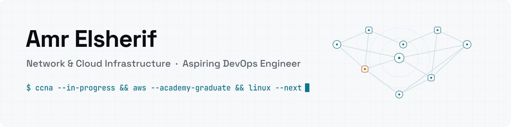
</picture>

  
  <a href="https://amrelsherif-eng.vercel.app/resume">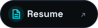</a>
  
  

<picture>
  <source media="(max-width: 767px)" srcset="assets/neofetch-mobile.svg">
  
</picture>

<picture>
  <source media="(max-width: 767px)" srcset="assets/h-roadmap-mobile.svg">
  
</picture>

<picture>
  <source media="(max-width: 767px)" srcset="assets/roadmap-mobile.svg">
  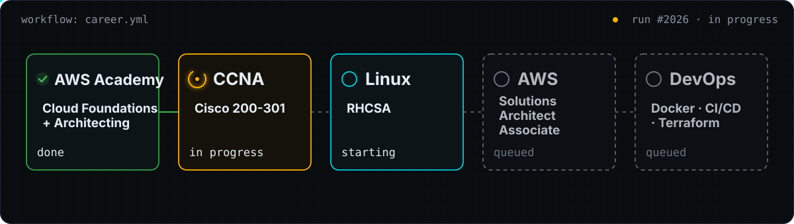
</picture>

<picture>
  <source media="(max-width: 767px)" srcset="assets/h-work-mobile.svg">
  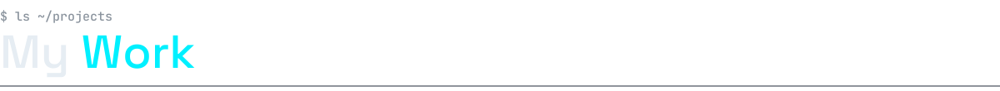
</picture>

<a href="https://amrelsherif-eng.vercel.app/lab">
  <picture>
    <source media="(max-width: 767px)" srcset="assets/project-network-lab-mobile.svg">
    
  </picture>
</a>

<a href="https://github.com/amrelsherif-eng/weatherlink">
  <picture>
    <source media="(max-width: 767px)" srcset="assets/project-weatherlink-mobile.svg">
    
  </picture>
</a>

<a href="https://github.com/amrelsherif-eng/devsync_flutter">
  <picture>
    <source media="(max-width: 767px)" srcset="assets/project-devsync-mobile.svg">
    
  </picture>
</a>

<a href="https://github.com/amrelsherif-eng/ats-resume-templates">
  <picture>
    <source media="(max-width: 767px)" srcset="assets/project-resume-template-mobile.svg">
    
  </picture>
</a>

<a href="https://github.com/amrelsherif-eng/portfolio">
  <picture>
    <source media="(max-width: 767px)" srcset="assets/project-portfolio-mobile.svg">
    
  </picture>
</a>

<picture>
  <source media="(max-width: 767px)" srcset="assets/project-lifi-mobile.svg">
  
</picture>

<picture>
  <source media="(max-width: 767px)" srcset="assets/h-certs-mobile.svg">
  
</picture>

<a href="https://amrelsherif-eng.vercel.app/certifications">
  <picture>
    <source media="(max-width: 767px)" srcset="assets/certs-mobile.svg">
    
  </picture>
</a>

<picture>
  <source media="(max-width: 767px)" srcset="assets/cta-mobile.svg">
  
</picture>

<a href="mailto:amrelsherif.eng@gmail.com">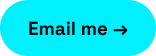</a>

